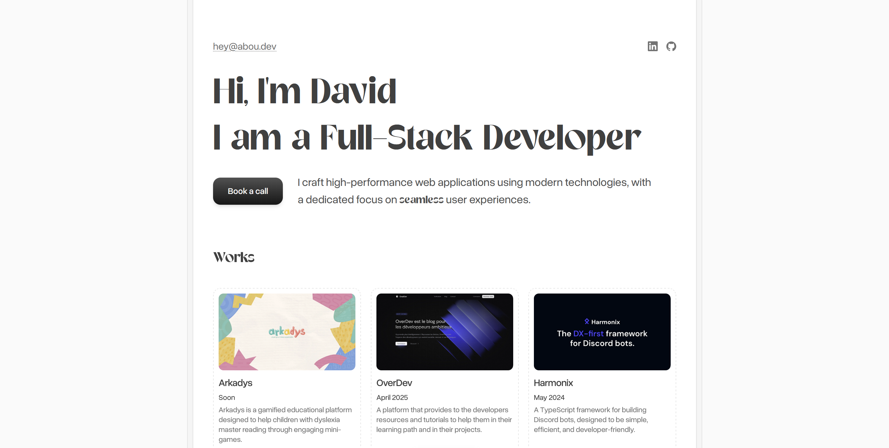

# Folio

My personal portfolio, live at **[folio.abou.dev](https://folio.abou.dev)**.

A single-page site with my selected works, the timeline that got me here, and a way to [book a call](https://cal.com/david-abou/30min).



## Stack

- [Nuxt 4](https://nuxt.com) with [Nuxt Content](https://content.nuxt.com) for all the page content
- [Nuxt Studio](https://nuxt.studio) to edit the content from the browser (`/admin`)
- [Tailwind CSS 4](https://tailwindcss.com) and [Motion for Vue](https://motion.dev/docs/vue) for styling and animations
- [Nuxt SEO](https://nuxtseo.com) for meta tags, sitemap and robots
- [nuxt-llms](https://github.com/nuxtlabs/nuxt-llms) to generate `llms.txt` and `llms-full.txt`
- Deployed on [Vercel](https://vercel.com), with Vercel Analytics

## Getting started

Requires Node.js and [pnpm](https://pnpm.io).

```bash
pnpm install
pnpm dev        # http://localhost:3000
```

| Command         | Description                          |
| --------------- | ------------------------------------ |
| `pnpm dev`      | Start the dev server                 |
| `pnpm build`    | Build for production                 |
| `pnpm generate` | Prerender the site as static files   |
| `pnpm preview`  | Preview the production build locally |
| `pnpm lint`     | Check formatting with Prettier       |
| `pnpm lint:fix` | Fix formatting with Prettier         |

## Editing the content

Everything shown on the site lives in `content/`, so most updates need no code change.

```
content/
├── index.md        # Home page: hero, works section, timeline
└── works/          # One JSON file per project
    ├── arkadys.json
    ├── harmonix.json
    └── overdev.json
```

### Home page

`content/index.md` uses [MDC](https://content.nuxt.com/docs/files/markdown#mdc-syntax) components (`::hero`, `::section-item`, `:::timeline`). The props of each block (greetings, call-to-action link, timeline events…) are set in its YAML block.

### Adding a project

Create a new file in `content/works/`:

```json
{
  "name": "My project",
  "description": "What it does, in one or two sentences.",
  "category": "Website",
  "stack": ["Nuxt", "TypeScript"],
  "thumbnail": "/assets/works/my-project.png",
  "url": "https://example.com",
  "releaseDate": "2026-01-31"
}
```

Put the thumbnail in `public/assets/works/`. The schema is defined in `content.config.ts`.

### From the browser

Nuxt Studio is mounted on `/admin` and commits changes straight to this repository.

## Project structure

```
app/
├── assets/         # Global CSS and custom SVG icons (custom: prefix)
├── components/     # UI components (Works, Timeline, Tilt, LetterSwap…)
│   └── content/    # Components used from Markdown (Hero, SectionItem)
├── layouts/
└── pages/
content/            # Site content (see above)
public/             # Fonts, images and Open Graph image
```

## Contact

- Email: [hey@abou.dev](mailto:hey@abou.dev)
- Book a call: [cal.com/david-abou/30min](https://cal.com/david-abou/30min)
- Other projects: [abou.dev](https://abou.dev)
